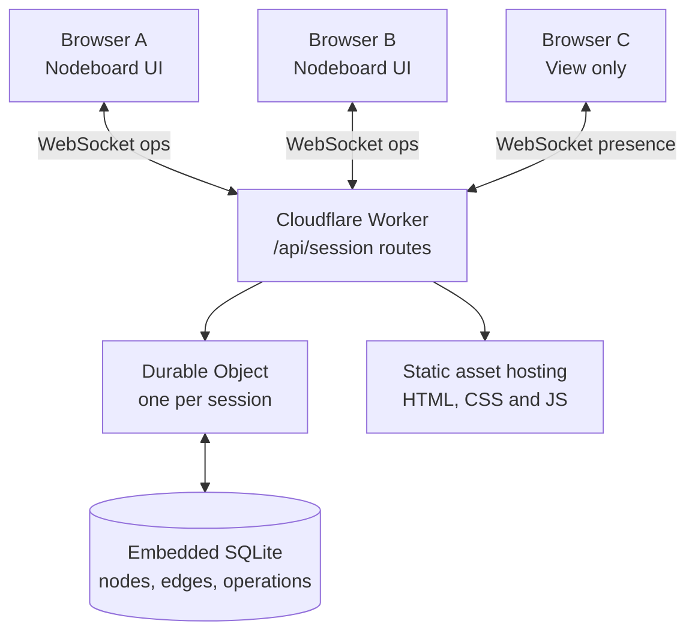

# Nodeboard Live — implementation and deployment guide

**Status:** Oct 29, 2026 starter. A collaboration-aware HTML editor and a Cloudflare Worker/Durable Object implementation are included. The JavaScript passes syntax checks; **the Worker has not been deployed, and two-browser end-to-end synchronization has not yet been verified**. Have Codex complete the tests and fixes in this specification before using it as a production workshop tool.

## 1. Product definition

Nodeboard is a keyboard-first, freeform *graph whiteboard*, not a full graph database or a generic diagramming suite. The essential activity is to double-click anywhere to create a connected node, immediately type its label and relationship, and repeat at conversational speed.

The multiplayer edition adds room creation, secure share links, a join interface, realtime edits, live presence, persistent sessions, read-only guests, reconnect, and backups **without breaking the fast local workflow**.

### Must not regress

- Double-click a node to add a connected child; double-click the canvas to add a node connected to the most recent/selected node; Alt+double-click for an unconnected node.
- Type the node name, press Enter to edit the edge relationship, Enter to finish.
- Single-click, drag to move; pan/zoom canvas; right-click node/edge to style or edit.
- `1`–`9` change the selected node's class or choose the creation class. `0`, class number, Enter selects class 10+.
- Unlimited *user-defined* classes in local mode; each gets a name, shape, colour and integer shortcut. Warn if shape+colour is already used; allow an intentional override.
- Node and edge labels, shape overrides, colour overrides, JSON import/export, SVG/PNG export, undo/redo in local mode, automatic local browser persistence.
- No focus-jumping when creating/editing nodes. No page scroll during canvas interactions. Export valid editable JSON.

## 2. Architecture



**Hosting:** Deploy static assets and the Worker in *the same Cloudflare Worker project*. Prefer Wrangler for dev and deploy. This avoids CORS and an additional service. Use a **SQLite-backed** Durable Object per session, with the **WebSocket Hibernation API** (`this.ctx.acceptWebSocket(server)`, `webSocketMessage`, `serializeAttachment`). Do not put the authoritative graph solely in Worker memory or `localStorage`.

**Sources:** [Wrangler configuration](https://developers.cloudflare.com/workers/wrangler/configuration/), [Worker static assets](https://developers.cloudflare.com/workers/static-assets/), [WebSocket hibernation](https://developers.cloudflare.com/durable-objects/best-practices/websockets/), [SQLite storage API](https://developers.cloudflare.com/durable-objects/api/sqlite-storage-api/), [Durable Object limits](https://developers.cloudflare.com/durable-objects/platform/limits/).

### Repository structure

```text
nodeboard-live/
  public/
    index.html           # Updated app, still standalone in local mode
    _headers             # Basic response headers
  src/
    index.js             # Worker HTTP router and BoardSession Durable Object
  docs/
    BUILD_GUIDE.md       # This specification
    CODEX_START_PROMPT.md
  package.json
  wrangler.jsonc
  .gitignore
```

For long-term maintainability, split the inline HTML CSS and JavaScript into `public/styles.css`, `public/editor.js`, and `public/collaboration.js` **only after the starter passes baseline regression tests**. Do not rewrite the canvas in React just to achieve multiplayer.

## 3. User journeys

### A. Start a workshop
1. User edits a graph locally.
2. Clicks **Collaborate → Create session**.
3. Enters session title and display name.
4. App POSTs current graph to `/api/sessions`. Backend creates random 128-bit session ID, 192-bit editor token, 192-bit viewer token, and associated SQLite room.
5. App opens room WebSocket and authenticates with the editor token.
6. Session owner copies editor link or editor invitation code. Viewer link is separate.
7. Participants open an invite link or paste a code to join.
8. UI shows connection status, session ID and participants. Every accepted edit appears for everyone.

### B. Join from an invitation
1. The share URL uses **URL fragment** `#s=<sessionId>&key=<token>` rather than query parameters (so the access key is not sent during HTTP page navigation).
2. Client extracts the fragment, connects to `/api/sessions/<sessionId>/ws`, then sends the token inside the initial WebSocket `auth` message.
3. Backend verifies SHA-256 hash of the token against stored editor/viewer token hash and sends `welcome` with role and authoritative graph.
4. Editor can edit; viewer can inspect and pan/zoom, but not modify data.
5. On disconnect, edits are disabled; client reconnects with backoff and receives a fresh authoritative snapshot.

### C. Return to local
- The user's local graph is preserved separately. Joining never writes room state to `nodeboard-v1.1`.
- Leave closes WebSocket and restores the prior local graph.
- Local JSON/SVG/PNG export stays available even without backend access.

### D. Session persistence
- Closing all browsers must **not** delete the board. Reopening the same valid link restores current graph after the object has hibernated or after a deploy.
- Use a server-side ownership/deletion policy. Do not silently delete workshop graphs by short TTL during pilot.

## 4. Current interface and protocol

The HTML shipped with this package already contains:
- Collaborate dialog: Create, Join, active session, copy invitation links/code, Leave.
- Status states: local, connecting, live editor, live viewer, disconnected.
- Basic participant count/avatars from server presence events.
- Local-vs-room graph isolation and reconnect logic.
- Operation diffing from editor mutations instead of pushing entire graph on every edit.
- Durable stable IDs for **new nodes and edges** using `crypto.randomUUID`.
- Local undo/redo disabled during live collaboration to avoid reverting another editor's work.

The implementation **still needs proper end-to-end integration, hardening, and tests**. The starter does not yet render remote cursors, provide account-level ownership, or enforce a production abuse-control policy.

### HTTP

`GET /api/health` → `200 {"ok":true,"service":"nodeboard-live","version":1}`

`POST /api/sessions`

```json
{
  "name": "NEXUS workshop",
  "displayName": "Alex",
  "graph": {"classes": [], "nodes": [], "edges": []}
}
```

`201` response:

```json
{
  "id": "cryptographically-random-room-id",
  "editToken": "cryptographically-random-editor-token",
  "viewToken": "cryptographically-random-viewer-token",
  "revision": 0
}
```

The example `classes` is structurally illustrative only: an actual valid graph must have **at least one class**. A room's access tokens must only be returned to the creator and never exposed through `/api/health` or a public graph endpoint.

`GET /api/sessions/:id/ws` → WebSocket upgrade. WebSocket authentication occurs before any graph data is returned. Reject unexpected origins, missing/invalid tokens, and viewer edits.

### WebSocket messages — client → server

```json
{"type":"auth","token":"editor-or-viewer-token","clientId":"browser-uuid","name":"Alex","pendingOpIds":["uuid-op-a"]}
```

```json
{
  "type": "ops", "opId": "uuid", "baseClassesRev": 2,
  "ops": [
    {"type":"node.upsert","node":{"id":"n-uuid","x":120,"y":50,"name":"Service","classId":1}},
    {"type":"edge.upsert","edge":{"id":"e-uuid","from":"n-uuid","to":"other-node-id","label":"DEPENDS_ON"}}
  ]
}
```

Supported atomic operation types: `node.upsert`, `node.patch`, `node.delete`, `edge.upsert`, `edge.patch`, `edge.delete`, `classes.replace`.

Example targeted patch (for concurrency):

```json
{"type":"node.patch","id":"n-uuid","patch":{"x":270,"y":90}}
```

Do not send a full graph snapshot for every drag. The server validates operations and commits all ops within a single message transaction. `classes.replace` must check expected `baseClassesRev` to avoid silently overwriting another participant's class schema.

### WebSocket messages — server → client

```json
{
  "type":"welcome","name":"NEXUS workshop","role":"editor",
  "revision":34,"classesRev":2,
  "graph":{"classes":[],"nodes":[],"edges":[]},
  "participants":[{"clientId":"uuid","name":"Alex","role":"editor"}],
  "acknowledgedOpIds":["uuid-op-a"]
}
```

```json
{"type":"ops","opId":"uuid","clientId":"author-uuid","revision":35,"classesRev":2,"ops":[{"type":"node.patch","id":"n-uuid","patch":{"name":"Renamed"}}]}
```

```json
{"type":"ack","opId":"uuid","revision":35,"classesRev":2}
```

```json
{"type":"presence","participants":[{"clientId":"uuid","name":"Alex","role":"editor"}]}
```

```json
{"type":"error","code":"CLASS_CONFLICT","message":"Node classes changed; reconnect"}
```

A successful author edit is **persisted before** the Durable Object sends the ACK/broadcast. Replaying an `opId` is idempotent (server stores a processed-op log) and must never duplicate nodes. For remote messages, the client should skip echoing its own operation.

## 5. Data and concurrency rules

### Nodes

```ts
type Node = {
  id: string;             // stable globally unique string
  x: number; y: number;
  name: string;
  classId: number;        // starter format; migrate to stable class UUID
  shapeOverride?: Shape | null;
  colorOverride?: string | null;
};
```

### Edges

```ts
type Edge = {
  id: string;
  from: string;
  to: string;
  label: string;
};
```

### Classes

```ts
type NodeClass = {
  key: number;            // visible shortcut/order, 1..N
  name: string;
  shape: 'rounded'|'rectangle'|'pill'|'ellipse'|'diamond'|'hexagon'|'document'|'circle';
  color: string;          // #RRGGBB
};
```

**Important schema improvement before production:** The existing Nodeboard implementation renumbers classes after a class deletion. Refactor classes to have a stable UUID `id` and a separate mutable shortcut/index `key`. Nodes should refer to `classId` as a stable UUID. The first release can retain numeric IDs for compatibility, but production concurrency should not depend on class list positions. Add a JSON import migration for legacy numeric class references. A class-delete operation should explicitly reassign affected nodes in the same transaction, without changing unrelated class IDs.

### Conflict semantics

- **Two participants add separate nodes:** both additions survive. IDs never collide.
- **Participant A moves Node X while B renames Node X:** send field-level patches; merge x/y with name. Do not overwrite the entire node object.
- **A and B edit the same field:** server-ordered last accepted write wins in MVP; no claims of CRDT conflict-free editing.
- **A deletes while B edits same node:** deletion wins; reject a patch to a missing node; reconnect/resync with clear feedback. Do not resurrect deleted nodes unless explicitly creating a new node.
- **Both change class definitions:** `classesRev` guards changes. Queue class operations in order; reject stale versions and resync.
- **A creates node and edge in one action:** send them in the same atomic message; don't show broken/dangling edges.
- **Connection drops immediately after send:** client sends `pendingOpIds` during auth. Server returns `acknowledgedOpIds` in `welcome`; client first removes those already applied, then reapplies only unacknowledged edits locally and resends them. Backend deduplicates acknowledged operations. Acknowledge only after persistence.
- **Undo/redo:** disabled in live MVP. Before enabling it, implement per-user compensating operations rather than replacing a past full snapshot; never undo other participants' changes.

## 6. Database and lifecycle

Starter Durable Object owns:
- `nodes(id PRIMARY KEY, data TEXT)` and `edges(id PRIMARY KEY, data TEXT)`
- `processed_ops(op_id PRIMARY KEY, revision, created_at)` for duplicate suppression
- SQLite-backed synchronous KV for `meta` (title, hashed tokens, classes, revisions, created date).

On initialization, write graph and metadata once. For subsequent changes, update **only changed node/edge rows** (the starter uses a before/after comparison) rather than deleting/reinserting the entire graph on each action. Clean old processed-op entries carefully: clients offline longer than dedupe horizon need a safer recovery/merge policy, not blind replay. Implement graph snapshot history/backups for production.

Durable Object connections should use `ctx.acceptWebSocket(server)` with serialized connection attachments so participant identity and role survive hibernation. On object restart, re-read SQLite/KV state; do not rely on in-memory arrays as authority.

## 7. Security, privacy and operational rules

**MVP access model:** possession of a high-entropy editor invite permits editing. Possession of a different viewer invite permits viewing. The short visible session ID is **not an authentication secret**. Never present a six-digit/short code as sufficient access control for private information. The UI supports full invitation code `NB:<id>:<token>` and URL fragments.

- Generate tokens using Web Crypto. Persist only their SHA-256 hashes server-side. Do not expose in logs/analytics.
- Serve app over HTTPS (except localhost dev); use WSS; set `Referrer-Policy: no-referrer`.
- Check `Origin` on WebSocket handshake; validate server-side role on **every mutation**.
- Validate lengths, IDs, shapes, hex colours, coordinates, graph referential integrity, max operations and byte sizes server-side. Never trust client HTML or JSON. Escape all user-supplied labels before inserting in DOM/SVG.
- Add WAF/rate limiting or Turnstile for public session creation, per-IP throttling for session creation, WebSocket/auth attempts, and a configurable maximum participants per session. The starter has only basic room capacity and input-size limits.
- Add creator-controlled revoke/rotate links, session deletion, export/restore, TTL/retention, and incident/audit logging **before institutional rollout**.
- No personally identifying or confidential York information until institutional data classification, approved tenancy/region, privacy, access control, and retention have been reviewed.
- Protect against accidental copy of a viewer token into an editor flow. Test read-only mode at server level, not merely disabled buttons.

## 8. Realtime UX refinements for Codex

### Priority 1: high-quality MVP
- Finish live create/join, editing and reload in two windows using actual local Wrangler.
- Guarantee that when a user closes the browser during editing, pending changes are not silently discarded. Show a visible state for unconfirmed edits, and offer JSON export.
- Implement accessible modal focus trapping/Escape and robust error messages.
- Preserve local graph while joining/leaving. Preserve viewport when remote operations arrive; don't call `fitView()` for every edit.
- Add `nodeboard-room-backup` recovery export without overwriting local graph.

### Priority 2: multiplayer presence
- Send ephemeral cursor position at <=10 messages/sec, remote selection and optional editing indicator. Broadcast but **do not persist** presence in SQLite.
- Each participant gets a consistent session colour. Show remote cursors and labels. Use updates to only move SVG cursor overlays; do not rerender the entire graph for cursor events.
- Render current participant list; show online/offline status, connection retry, and clear local-only vs synchronized state.

### Priority 3: workshop features
- Host can rename, duplicate, export, archive and delete a room; revoke editor/viewer invite.
- Viewers can optionally follow presenter viewport (not mandatory by default).
- More intuitive inline edge label editing and quick-add relationship presets.
- Optional `Lock board` toggle for workshops, and a simple light/dark theme later.

## 9. Exact local setup

From a terminal in the project directory:

```bash
npm install
npm run dev
```

Wrangler prints a localhost URL (often `http://127.0.0.1:8787`). Open it in two separate browser windows. The HTML file opened directly from disk supports **local mode only**, not live sessions.

1. On window A, **Collaborate → Create session**, name it, enter your display name.
2. Copy the **Editor link** and paste into window B.
3. Create a new node in window A and rename it. B should show it without refreshing.
4. Move the node in B while renaming it in A. Both changes should survive.
5. Add a class in A and verify it is visible and available to B.
6. Reload both windows. The graph persists.
7. Copy **Viewer link** to a third window. Editing must be rejected by the server.
8. Close all connections, reopen one invitation, and verify persistence.

If the Worker fails, check `npx wrangler tail`, browser devtools Network → WS, Worker logs, and whether the SQLite-backed Durable Object migration was applied.

## 10. Cloudflare deployment

```bash
npx wrangler login
npm run deploy
```

Deploy creates a `*.workers.dev` hostname (if enabled). Use that as the primary origin for session share links. Optionally attach a custom domain (e.g. `board.example.com`) in Cloudflare. Keep the app and API on the **same origin**.

`wrangler.jsonc` includes a SQLite-backed Durable Object migration, Static Assets, and worker-first `/api/*` routing. Cloudflare now also supports a declarative `exports` field for new Durable Object classes; legacy `migrations` remains supported. **Do not combine `exports` and `migrations` in one Wrangler config.**

### Operational checks

- `GET /api/health` works on deployed domain.
- HTTPS and WSS succeed from a different network.
- Share links work in incognito and a second device.
- No editor tokens appear in server logs or query strings.
- Viewer token can read but cannot change graph even with forged WebSocket messages.
- Refresh, disconnect, hibernation and redeploy preserve graph.
- Set alerting/quotas and backup retention for anything beyond a small prototype.

## 11. Acceptance-test matrix

| Scenario | Expected |
|---|---|
| Local no network | All original editor tools still work |
| Create session from existing graph | Initial nodes/edges/classes copied; local original safe |
| Join with editor invite | Full graph loads and stays in sync |
| Join with viewer invite | Read-only, cannot write through direct WebSocket message |
| Two people add nodes simultaneously | Both survive, unique IDs |
| Two people move different nodes | Neither move is lost |
| Move and rename same node simultaneously | Both fields survive |
| Node deleted vs stale rename | No node resurrection; safe visible conflict |
| Class colour+shape duplicate | Warn, permit explicit override; sync to all |
| Add >9 classes | `0` + number selects any class; synced correctly |
| Class removed/reordered | No orphaned numeric references |
| Imported legacy JSON | Graph migration preserves semantic classes |
| WS disconnect while editing | Clear pending state, reconnect, no silent overwrite |
| Reload browser | Same graph and valid role |
| DO hibernation/redeployment | Persisted graph survives |
| Duplicate `opId` | Exactly once applied; same ACK on retry |
| Invalid op/huge payload | Server rejects, retains valid state |
| PNG/SVG/JSON export | All valid and unaffected by other users |

## 12. Definition of done

1. Current Nodeboard local interaction tests pass.
2. Cloudflare dev server runs with a working Durable Object and no console errors.
3. Two editors and one viewer pass the above tests.
4. Node/edge/class data persists through full disconnection and server restart.
5. Collaborative edits do not replace whole-board snapshots or silently override unrelated changes.
6. Security tests cover role enforcement, token secrecy, validation, and rate limits.
7. README contains one-command local development, deployment, and troubleshooting.
8. Record any remaining limitations honestly (especially simultaneous same-field edits and collaborative undo).
